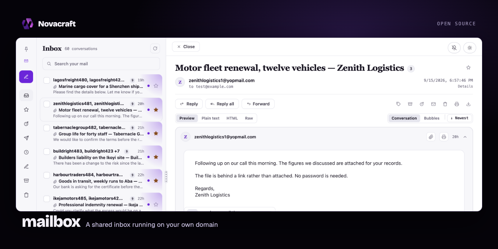

# Mailbox

A shared webmail app you host yourself. One codebase, one deployment per
mailbox. Inbox and threads, a composer with signatures and templates,
attachments on S3-compatible storage, sharing links, full-text search, web
push, PWA install, accounts with roles, and password reset.

Everything specific to you — name, domain, colours, signature copy, artwork —
lives in configuration. Nothing in this repository names or pictures any one
business, and nothing added to it should.

## Running your own

1. Copy `.env.example` and fill it in.
2. Put three images on the volume at `BRAND_ASSET_DIR`. See
   [public/brand/README.md](public/brand/README.md) for the sizes.
3. Point `DATABASE_URL` at a SQLite file on a mounted volume.
4. Deploy it anywhere that runs Next.js. The schema is created on first boot
   and migrates itself forward, so there is no migration step to run.

It is a plain Next.js app, so Vercel, Coolify, Docker on a VPS, Fly, Render and
Railway all work. Nothing in the code assumes a particular host.

## Trying it locally

Outside production the app seeds one account for you — `test@<MAIL_ADDRESS_DOMAIN>`,
an admin whose password is the address itself — so a fresh checkout can be
signed into without configuring seats. It is never seeded when
`NODE_ENV=production`.

`node --experimental-strip-types scripts/seed-dev.mjs` then fills that mailbox
with enough traffic to exercise the list, search, paging and attachments.
Create the schema first by starting the app once, or by calling
`ensureMailSchema()`.

The attachments are real files, not records: a PDF, a photo, a short video, a
spreadsheet and a Word document, generated on the spot and uploaded once.
Pictures and video need `ffmpeg` and the document needs `zip`; whatever is
missing is skipped. With no bucket configured the seed still runs and writes
the records alone.

## Configuration

`lib/brand.ts` is the server-side source of identity — name, domain, signature
copy, colours, seats, aliases. `lib/brand.client.ts` is the browser half, read
from `NEXT_PUBLIC_*` and inlined at build time, so changing anything the
browser shows means a rebuild.

Seats are JSON in `MAIL_SEATS` and seed on first boot only; after that you
manage accounts in the app. `MAIL_ADDRESS_ALIASES` copies a seat's incoming mail
to someone else who also reads it; the seat keeps its own copy.

## Storage

`DATABASE_URL` is any SQLite or libSQL database. A `file:` URL is local SQLite
on a mounted volume, which is what a single box wants. A `libsql://` URL points
at a hosted one — Turso, or your own `sqld` — and takes `DATABASE_AUTH_TOKEN`.

Attachments go to any S3-compatible bucket through the `S3_*` variables: AWS
S3, Cloudflare R2, Backblaze B2, MinIO, Wasabi. The older `R2_*` names still
work if you already set them.

**The bucket needs a CORS rule.** The browser uploads straight to it with a
signed URL, so the bucket has to allow `PUT`, `GET` and `HEAD` from the address
the app is served on. Without one every attachment fails, and the browser
reports it the same way it reports being offline — so it reads as a network
problem rather than a missing rule. On R2:

```json
[{ "AllowedOrigins": ["https://mail.example.com"],
   "AllowedMethods": ["PUT", "GET", "HEAD"],
   "AllowedHeaders": ["*"],
   "ExposeHeaders": ["ETag", "Content-Length", "Content-Type", "Content-Disposition", "Content-Range", "Accept-Ranges", "Last-Modified"],
   "MaxAgeSeconds": 3600 }]
```

List only your own origin. A wildcard lets any page that obtains a signed URL
upload with it.

## Sending

Every message goes through Vela, read from `VELA_API_URL` and `VELA_API_KEY` and nothing
else; Vela holds the provider credentials. Account email (sign-in and enrol codes, resets,
recovery confirmations, invites) carries the requester's IP, device, account and user agent
so Vela can pause a requester who asks too often, and password sign-in, code entry, PIN entry
and passkey sign-in ask Vela's guard first. A pause reaches the client as a 429 with `scope`,
`retry_after` and `blocked_until`; a recipient still cooling down is answered as a success
with `throttled: true`.

## Gmail and Outlook conventions

For every feature Vela shares with Gmail and Outlook (reply, reply all, forward, conversations, recipients, drafts, undo send, labels, search), Vela behaves the way Gmail and Outlook do today. Before building or changing anything that would work differently, ask the owner first in a dialog box: name the convention, say what Vela would do instead and why, and offer the conventional behaviour as one of the choices. Do not ship a difference the owner has not chosen.

Decisions the owner has made (2026-11-05):
- **Reply** goes to the sender of the message being answered (its Reply-To if set). Replying to a message we sent ourselves goes to the people it was sent to.
- **Reply all** goes to that one message's sender, To and Cc, minus only the mailbox replying and the address you send as. Colleagues on the message stay on the reply. It never adds people from other messages in the conversation, and never anyone from Bcc.
- **Forward** starts with no recipients and carries the original's attachments.
- **Conversations**: a message joins the conversation it replies to (In-Reply-To and References, including replies to our own sent mail) and only while the subject stays the same. The same subject alone never joins messages. This is stricter than Gmail, which also joins a message with no reply headers when the subject and sender or recipients match within a week; the owner chose the stricter rule. Mail received before 5 November 2026, including the imported Google Workspace history (which kept no reply headers), keeps its earlier grouping: same subject and a shared company or person.
- **Send delay** stays at 20 seconds by default (longer than Gmail's 5, within its 5 to 30 range), so Undo works.
- **No recipient warnings**: whoever is typed into To, Cc or Bcc gets the mail, as in Gmail and Outlook.

## Mobile discovery

Vela Mail requires the backend's mobile session support and public
`/.well-known/mailbox` route. Deploy the updated shared image to every mailbox
instance; updating the mobile app alone cannot enable these endpoints.

Discovery uses each instance's `BRAND_NAME`, `MAIL_PUBLIC_URL`,
`BRAND_ACCENT_HEX` (falling back to `NEXT_PUBLIC_BRAND_ACCENT`) and
`BRAND_CHROME_MARK_URL`. Its accepted domains include `MAIL_ADDRESS_DOMAIN`,
`MAIL_DEFAULT_ADDRESS_DOMAIN`, `MAIL_ADDRESS_DOMAINS` and
`NEXT_PUBLIC_MAIL_ADDRESS_DOMAINS`. It never publishes individual accounts.

After rollout, verify discovery returns JSON with `protocol: novacraft-mailbox`,
`version: 1`, the correct brand and all login domains. Unauthenticated requests
to `/api/mail/me` and `/api/mail/mobile/devices` must reject access. Finally,
verify a real native sign-in, including two-factor authentication where enabled;
public endpoint checks alone do not establish successful login.

## Tests

```
npx tsx --test lib/*.test.ts
```

## Licence

MIT. See [LICENSE](LICENSE).
